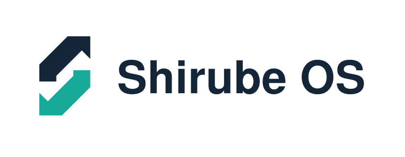

<p align="center"></p>

# Shirube OS

## Table of Contents / 目次

- [English](#english)
  - [Overview](#overview)
  - [Download and verify](#download-and-verify)
  - [Installation and first boot](#installation-and-first-boot)
  - [Release and validation](#release-and-validation)
  - [Development and support](#development-and-support)
- [日本語](#日本語)
  - [概要](#概要)
  - [ダウンロードと検証](#ダウンロードと検証)
  - [インストールと初回起動](#インストールと初回起動)
  - [リリースと検証状況](#リリースと検証状況)
  - [開発とサポート](#開発とサポート)

## English

### Overview

Shirube OS is an open-source router operating system based on VyOS Stream,
built and maintained by michibiki-io. It uses the VyOS configuration CLI and
adds features such as [NetBird client integration](docs/NETBIRD.md).
This repository contains the source locks, patches, and tooling that build,
test, and publish the images and their corresponding sources.

Shirube OS is an independent distribution. It is not an official VyOS product
and is not affiliated with or endorsed by VyOS. Upstream components retain
their own copyrights and licenses.

### Download and verify

1. Open the [latest published release](https://github.com/michibiki-io/shirube-os/releases/latest)
   and expand **Assets**. For an older version, use
   [all releases](https://github.com/michibiki-io/shirube-os/releases).
2. Match the image to the architecture of the machine or VM that will boot it:
   `amd64` for 64-bit Intel/AMD (x86-64), or `arm64` for 64-bit Arm (AArch64).
3. Choose an `.iso` to boot the installer, a `.qcow2` for QEMU/KVM, or a
   streamOptimized `.vmdk` for a virtualization platform that can import that
   VMDK format. The disk images already have Shirube OS installed.
4. Download `SHA256SUMS` from the **same release** into a directory containing
   only the downloaded release files. From that directory, run:

   ```sh
   sha256sum --ignore-missing -c SHA256SUMS
   ```

   Make sure the exact image filename is reported as `OK` before booting it.
   If it fails or does not appear, do not use the file. This checks the downloaded
   bytes against the published hashes; it is not signature verification.

### Installation and first boot

- **ISO:** Boot from the installer media, complete administrator enrollment,
  then run `install image` as an administrator. Choose the target disk carefully:
  installation can erase its contents. Remove the ISO before booting the installed disk.
- **QCOW2 or VMDK:** Use a copy of the image as the VM's boot disk and configure
  the VM for UEFI. The AMD64 ISO can also boot with BIOS; the ARM64 ISO uses UEFI.
- **First access:** There is no shared default password. Without usable cloud-init
  data, use the console to create an administrator with a password of at least
  16 characters. For automated provisioning, use cloud-init (for example,
  NoCloud) to provide an administrator and SSH keys. After login, use the router
  CLI: enter `configure`, make changes with `set`, then `commit` and `save`.

See [first boot and cloud-init](docs/FIRST_BOOT.md) for details. This repository
does not upload or import images into a cloud provider or deploy them. A local
VM test does not verify compatibility with OCI or another cloud service.

### Release and validation

Release tags follow the pinned Stream baseline: the first Shirube revision for
`2026.03` is `v2026.03.0`, the next is `v2026.03.1`, and the first for a new
`2026.04` baseline is `v2026.04.0`.

For a specific release, read its release notes and inspect `manifest.json` and
the per-architecture `*-evidence.json` files under **Assets**. Use the manifest to match
the image to its recorded hash and the evidence to see what was tested.
[Validation status and historical results](docs/VALIDATION.md) describe the
scope of repository checks. A static check does not prove that an image boots,
and a past result applies to the recorded artifacts, not to a later commit.

The [Linux 6.6.163 candidate evidence](docs/KERNEL-6.6.163.md) documents source,
patch, and configuration checks, not a published release. Native builds, signed
modules, installed boot, and networking require separate results for AMD64 and
ARM64 on the exact candidate commit.

### Development and support

- [Build inputs and native runners](docs/BUILD.md)
- [Staged hosted build and acceptance gaps](docs/STAGED-BUILD.md)
- [Release contract and recovery](docs/RELEASE.md)
- [Licenses and corresponding sources](docs/LICENSES.md) and [notices](NOTICE)

Run the static checks with `python3 -m unittest discover -s tests -v`.
Build tools, firmware, and QEMU belong in containers.

For a bug report or feature request, open a
[Shirube OS issue](https://github.com/michibiki-io/shirube-os/issues).
For a bug, include the release tag, architecture, image format, firmware mode,
and steps to reproduce it. Remove credentials and keys from any logs or configuration.

## 日本語

### 概要

Shirube OS は、michibiki-io が開発・保守する、VyOS Stream ベースの
オープンソースのルーター OS です。VyOS の設定 CLI を使え、
[NetBird クライアント連携](docs/NETBIRD.md)などの機能を追加しています。
このリポジトリでは、イメージと対応ソースのビルド・検証・公開に使うツール、
パッチ、入力ソースを固定するための定義を管理しています。

Shirube OS は独立したディストリビューションです。VyOS の公式製品ではなく、
VyOS との提携や VyOS による推奨もありません。上流コンポーネントの著作権と
ライセンスは、それぞれ元のままです。

### ダウンロードと検証

1. [最新の公開リリース](https://github.com/michibiki-io/shirube-os/releases/latest)
   を開き、**Assets** を展開します。以前のバージョンは
   [リリース一覧](https://github.com/michibiki-io/shirube-os/releases)から選べます。
2. 起動先の実機または仮想マシンに合わせて、64 ビット Intel／AMD（x86-64）なら
   `amd64`、64 ビット Arm（AArch64）なら `arm64` のイメージを選びます。
3. インストーラーを起動するなら `.iso`、QEMU／KVM で使うなら `.qcow2`、
   streamOptimized 形式に対応した仮想化環境へ取り込むなら `.vmdk` を選びます。
   ディスクイメージには Shirube OS がインストール済みです。
4. **同じリリース**の `SHA256SUMS` を取得します。ダウンロードしたリリースファイル
   だけを置いたディレクトリで、次を実行します。

   ```sh
   sha256sum --ignore-missing -c SHA256SUMS
   ```

   起動前に、選んだイメージのファイル名に `OK` が表示されることを確認します。
   照合に失敗した場合や一覧に表示されない場合は使用しないでください。
   このコマンドはファイルと公開ハッシュの一致を確認するもので、署名検証ではありません。

### インストールと初回起動

- **ISO：** インストールメディアから起動して管理者を登録し、管理者として
  `install image` を実行します。インストール先のディスクの内容が消去される
  場合があるので、対象を確認してください。インストール先から起動する前に ISO を取り外します。
- **QCOW2／VMDK：** イメージのコピーを仮想マシンの起動ディスクに指定し、
  ファームウェアを UEFI に設定します。AMD64 の ISO は BIOS でも起動でき、
  ARM64 の ISO は UEFI を使用します。
- **初回ログイン：** 共通の初期パスワードはありません。有効な cloud-init データが
  ない場合は、コンソールで 16 文字以上のパスワードを設定して管理者を作成します。
  自動で初期設定する場合は、NoCloud などの cloud-init データで管理者と SSH 公開鍵を渡します。
  ログイン後は、ルーターの CLI で `configure`、`set`、`commit`、`save` の順で
  設定を変更・保存できます。

詳しくは[初回起動と cloud-init](docs/FIRST_BOOT.md)を参照してください。
このリポジトリでは、クラウドへのイメージのアップロード、インポート、
デプロイは行いません。ローカル VM での試験は、OCI などのクラウド上での動作確認とは別です。

### リリースと検証状況

リリースタグは、固定した Stream のベースラインに合わせます。`2026.03` の初回は
`v2026.03.0`、同じベースラインの次の版は `v2026.03.1`、新しい `2026.04`
ベースラインの初回は `v2026.04.0` です。

各バージョンの確認には、リリースノートと **Assets** 内の `manifest.json`、
アーキテクチャ別の検証結果ファイル（`*-evidence.json`）を使います。
マニフェストで対象イメージと記録された
ハッシュを、検証結果ファイルで試験の内容を確認できます。
リポジトリで行った検証の範囲は[検証状況と過去の結果](docs/VALIDATION.md)に記録しています。
静的チェックだけでは起動を確認できません。過去の試験結果は記録された成果物に対するもので、
後続のコミットを検証した結果ではありません。

[Linux 6.6.163 候補の検証記録](docs/KERNEL-6.6.163.md)は、ソース、パッチ、
設定の確認結果であり、リリースの公開を示すものではありません。ネイティブビルド、
署名済みモジュール、インストール後の起動、ネットワーク動作は、同じ候補コミットで
AMD64 と ARM64 をそれぞれ検証した結果が必要です。

### 開発とサポート

- [ビルドの入力とネイティブランナー](docs/BUILD.md)
- [ホストランナーでの段階的ビルドと未検証項目](docs/STAGED-BUILD.md)
- [リリースの要件と復旧手順](docs/RELEASE.md)
- [ライセンスと対応ソース](docs/LICENSES.md)、[著作権・ライセンス表示](NOTICE)

静的チェックは `python3 -m unittest discover -s tests -v` で実行できます。
ビルドツール、ファームウェア、QEMU はコンテナで扱います。

不具合報告や機能要望は [Shirube OS の Issue](https://github.com/michibiki-io/shirube-os/issues)
に投稿してください。不具合の場合は、リリースタグ、アーキテクチャ、イメージ形式、
ファームウェアの設定、再現手順を添えてください。ログや設定から認証情報や鍵は取り除いてください。
